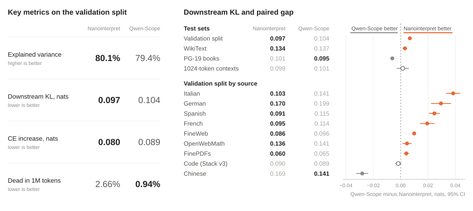
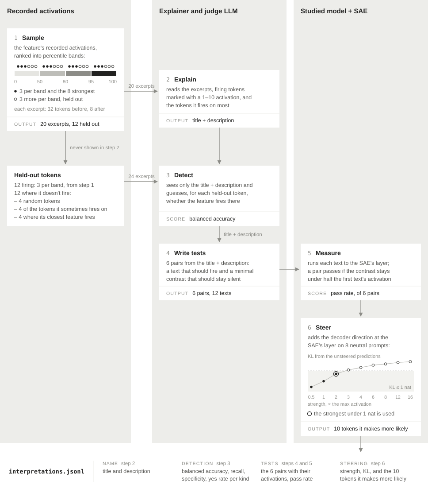

Nanointerpret objective is being a minimal but full-fledged interpretability playground where you can:
- Train your own [SAE](https://www.lesswrong.com/posts/8YnHuN55XJTDwGPMr/a-gentle-introduction-to-sparse-autoencoders)
- Record SAE feature activations
- Interpret and filter the features with any LLM
- Explore the features in a local dashboard and steer the model with them

## How does this work?

1. `train.py`: runs the LLM over data mix (web, PDF, code, math, multilingual content) captures the residual stream at one layer, and trains a Top-K SAE on it.
    - Attention-sink tokens and massive-activation dimensions are kept out of the SAE
    - the SAE is judged by how little it changes the LLM's predictions when its reconstruction is fed back in (downstream KL).
    - See [methodology](docs/overview.md#methodology), [hyperparameters](docs/overview.md#hyperparams), [ablations](docs/experiments.md#ablations), [massive activations](docs/experiments.md#massive-activations) behind the defaults.
2. `record_activations.py`: runs the trained SAE over held-out text
3. `interpret.py`: an LLM names each feature from its activations, then the name is checked on held-out tokens + tests, and by steering the model along the feature ([how it works](docs/interpretation.md)).
4. `explore.py`: serves a local dashboard to browse the features and steer the model.

## Train your SAE

1. Prepare the environment:

```sh
python3 -m venv .venv
source .venv/bin/activate
pip install -r requirements.txt
```

2. Then proceed to a guide:

- [Gemma3 270M Base](docs/training-guides/gemma.md) (~5GB free RAM required)
- [Qwen3 1.7B Base](docs/training-guides/qwen.md) (~14GB free RAM required)

## Comparison with Qwen-Scope

[Nanointerpret Qwen3 1.7B SAE](https://huggingface.co/Belluxx/nanointerpret-qwen3-1.7b-base-l11-k50) (layer 11, k50, 1B tokens) vs its [Qwen-Scope](https://huggingface.co/Qwen/SAE-Res-Qwen3-1.7B-Base-W32K-L0_50) equivalent.



## Interpretation pipeline

