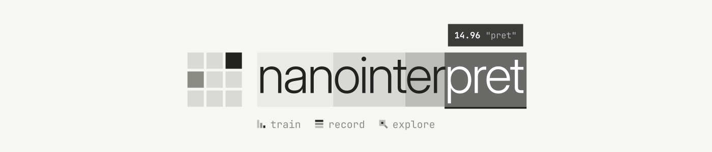

Nanointerpret objective is being a minimal but full-fledged interpretability playground where you can:
- Train your own [SAE](https://www.lesswrong.com/posts/8YnHuN55XJTDwGPMr/a-gentle-introduction-to-sparse-autoencoders) on your own LLM
- Record SAE feature activations
- Name the features with a local LLM, checking each name against held-out text and the model itself ([how](docs/interpretation.md))
- Explore the features in a local dashboard

To train your SAE locally, check [Train your SAE](#train-your-sae) below.

Want to know more about the decisions that went into making this project? Check [experiments.md](docs/experiments.md).

## Train your SAE

1. Prepare the environment:

```sh
python3 -m venv .venv
source .venv/bin/activate
pip install -r requirements.txt
```

2. Then proceed to a guide:

- [Gemma3 270M Base](docs/training-guides/gemma.md) (~5GB free RAM required)
- [Qwen3 1.7B Base](docs/training-guides/qwen.md) (~14GB free RAM required)

## Todos

- [ ] Test on instruct (chat) models
- [ ] Dead features: `--dead-window 1000000`, linear decay over last 20%