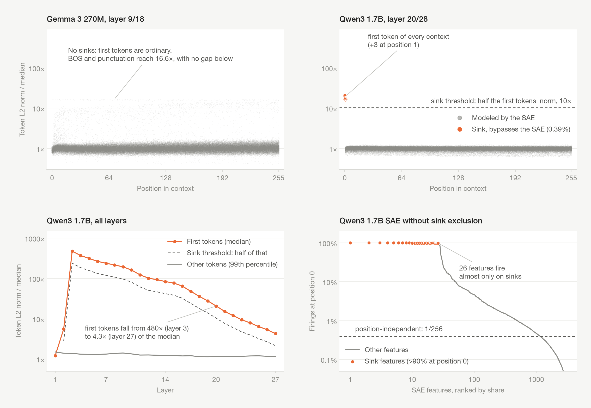
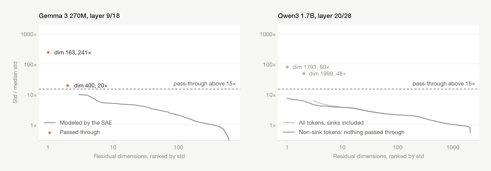

# Experiments

Hardware: M4 Max Mac Studio (CPU 16C, GPU 40C, 64GB RAM)

## Lessons learned

- Compare runs on downstream KL: MSE and explained variance change meaning with pass-through dims and sink exclusion.
- Lowering `K` from 32 to 16 improves interpretability at some reconstruction cost. Widening the SAE from 16x to 32x sometimes separates fused concepts, but needs more data, adds many duplicate features, and doesn't fix Gemma 270M's poor text understanding.
- A later-layer Gemma run gave more abstract features that turned incoherent already at medium activations: check the whole activation distribution, not just the top.
- FineWeb-Edu was a poor dataset: features picked up its educational style (a fire feature steered completions toward educational fire content), in both Gemma 3 270M and Qwen3 1.7B.

## Ablations

Runs train on 100M FineWeb tokens and validate on 10M held-out ones, with downstream KL on 1M of them (95% CIs are about ±0.005 for Gemma and ±0.002 for Qwen). Each row adds its flags to the base command.

<details>
<summary>Base commands</summary>

```sh
python3 train.py --model-id unsloth/gemma-3-270m --activation-layer 9 --k 16 --train-tokens 100000000 --validation-tokens 10000000 --recording-tokens 0 --validate-every 100000000 --cache-activations
python3 train.py --model-id unsloth/Qwen3-1.7B-Base --activation-layer 14 --train-tokens 100000000 --validation-tokens 10000000 --recording-tokens 0 --validate-every 100000000
```

</details>

Gemma 3 270M, layer 9, `k=16`:

| Run | Flags | Dead features | Downstream KL | Throughput |
|---|---|---:|---:|---:|
| Default | | 0.5% | 0.561 | 122k tok/s |
| No AuxK | `--aux-k-coef 0` | 9.5% | 0.573 | 126k tok/s |
| No pre-bias subtraction | `--no-subtract-pre-bias` | 6.0% | 0.599 | 130k tok/s |
| Neither | `--aux-k-coef 0 --no-subtract-pre-bias` | 79.8% | 0.899 | 142k tok/s |
| Gradient clipping | `--gradient-clip 1` | 0.5% | 0.557 | 79k tok/s |
| No pass-through dims | `--no-passthrough-massive-dims` | 2.0% | 0.683 | 120k tok/s |

- Pre-bias subtraction and AuxK both matter, and dropping both is far worse than dropping either.
- Gradient clipping makes no difference within the KL's confidence interval but slows training by 35%, so it's off by default.
- Passing [massive dimensions](#massive-activations) through lowers KL by 18%.

Qwen3 1.7B, layer 14, `k=32`:

| Run | Flags | Pass-through dims | Dead features | Downstream KL |
|---|---|---|---:|---:|
| Default | | none | 9.7% | 0.148 |
| No sink exclusion | `--no-exclude-sinks` | 1401, 1793, 1999 | 12.3% | 0.148 |

- Excluding [sink tokens](#massive-activations) leaves KL unchanged but lowers dead features, and frees the 36 features that otherwise fire almost only at position 0.

## Massive activations

A few residual dimensions carry extremely large activations that mark attention sinks. They hold little information but dominate SAE normalization and inflate explained variance (in Gemma 3 270M one dimension holds 96% of the variance). Two automatic fixes, both on by default, keep them out of the SAE; the bypassed values are fed back to the model unchanged.

- **Sink tokens** (`--no-exclude-sinks` to disable): tokens whose residual norm exceeds 30x the median token's. In Qwen, 0.39% of tokens: the first token of every context ([paper](https://arxiv.org/pdf/2605.11887), bottom of page 2; Qwen has no BOS) and rarely one at position 1-2. Their norm is 65-97x the median, while every other token stays under 4x. Gemma has none: its BOS and punctuation sinks stay under 17x.
- **Pass-through dims** (`--no-passthrough-massive-dims` to disable): dimensions whose std over non-sink tokens exceeds 15x the median dimension's. Gemma gets 163 and 400. Qwen gets none, as its massive dimensions only spike on sink tokens.





## Performance

- On MPS, compiling the layers before the capture point speeds up activation capture by ~2x for Gemma 3 270M, ~1.5x for Qwen3 0.6B, and ~1.2x for Qwen3 1.7B.
- With the defaults, Gemma 3 270M trains at ~122k tok/s on cached residuals and Qwen3 1.7B at ~6.3k tok/s streamed; both are GPU-bound.

## Feature interpretation

Names come from `interpret.py` ([method](overview.md#feature-interpretation)) on the Qwen3 1.7B run, with gemma-4-31B-it (Q8_0, llama-server) as explainer and judge. The design was settled on 60 features stratified by activation density, then the final pipeline ran on 40 others.

Detection on the 60 features, with the judge given different descriptions (before revision):

| Description | Balanced accuracy |
|---|---:|
| Explainer's | 0.69 |
| The feature's most frequent tokens only | 0.57 |
| Another feature's | 0.51 |

Final pipeline on the 40 other features, in 24 minutes (36 s per feature, 4 parallel requests on the M4 Max):
- Detection balanced accuracy 0.71. The judge says the feature fires on 80% of the activations in the top 5%, 66% at 80-95%, 51% at 50-80% and 28% in the bottom half; and on 3% of random tokens, 14% of the closest feature's activations and 26% of the feature's frequent tokens where it stays silent.
- Generated tests: 63% of pairs pass, 70% of features pass at least 4 of 6, 20% pass none.
- 40% of features pass both checks (detection at least 0.7 and 4 of 6 generated tests). 22% of the names come from the revision.

- Names describe the peak, not the tail: weak activations often land on arbitrary tokens in a topical context (any token of a firearms spec sheet), which a name doesn't predict.
- Detection alone overrates broad names, since the held-out examples share the training examples' quirks. Feature 29056 fires on the comma after page ranges in RePEc citations (`vol. 74(1), pages 119-147, September`): "academic citation volume and page range" scored 1.00 on detection, but none of 6 citations in other formats activated it. The two checks barely correlate (Spearman 0.17): detection measures coverage, generated tests precision.
- Until the margin below was chosen, a pair passed when the first text fired more by any margin; the design-phase numbers here use that rule.
- Revision with the measured activations raised the generated-test pass rate of the 28 failing names from 26% to 44% (10 then passed 4 of 6). Re-testing the original names on freshly sampled texts gave 28% (1 passed), so the gain isn't regression to the mean. Detection held (0.66 to 0.64) as names got narrower: the judge said yes to 41% of same-token negatives instead of 54%.
- Short texts suffice for generated tests: real top-activation excerpts fire as strongly alone as after a preceding paragraph.
- Any margin was too lenient: for feature 4064, an adjective after an indefinite pronoun ("something new", "nothing special"), every contrast still fired at 43-89% of the max, yet "positive or novel qualifiers" passed 5 of 6 pairs. A neutral sentence before a firing text (420 texts, 3 sentences) leaves the median activation unchanged, cuts it below 0.76x for only 5% of texts and halves it for 1.7%, while swapping words the feature doesn't care about moves it by up to half; so a pair now passes only if the contrast stays under half. That rule flips 23 of 175 passing pairs, and 4064 drops to 0 of 6. Agreement between two independent sets of generated texts for the same names falls slightly, from 0.78 to 0.70 (Pearson over features): the stricter rule tests a harder property.
- Logit-lens tokens in the explainer prompt made no difference (detection +0.002 ± 0.020, generated tests -0.025 ± 0.064, 95% CIs) and were dropped.
- gemma-4-12B-it decodes ~3x faster. As judge of the same names its per-feature detection correlates 0.81 with the 31B's, and it is slightly stricter (0.66 vs 0.69 detection, 54% vs 62% generated tests). As explainer, judged by the 12B, its names match the 31B's on detection (0.65 vs 0.66) but pass fewer generated tests (48% vs 54%).
- At a fixed 4x max activation the steering KL spans 0.5 to 5.8 nats (10th to 90th percentile), hence the per-feature calibration; the median feature stays within 1 nat up to 2x. Steering tokens often confirm the name (coal: " coal", " methane", " mines"), but some show an effect the name misses: feature 15393, "major sporting events", steers toward " terrorist", " protests", " ISIS".

<details>
<summary>Command for the 40 features</summary>

```sh
llama-server -m gemma-4-31B-it-Q8_0.gguf --port 8080 -c 32768 -np 4 -cram 0 --reasoning off
python3 interpret.py --sae-dir artifacts/qwen3-1.7b-base_l14_w16_k32_500m --base-url http://127.0.0.1:8080/v1 \
  --features 29735 7213 3573 4023 5255 20162 11626 12119 21637 10036 27736 25036 3303 16911 16739 5989 5509 29444 11997 7825 29895 20163 4064 8481 6118 20468 14934 4979 20010 20963 29412 7464 160 18972 16090 1877 27889 16601 5063 21072
```

</details>
