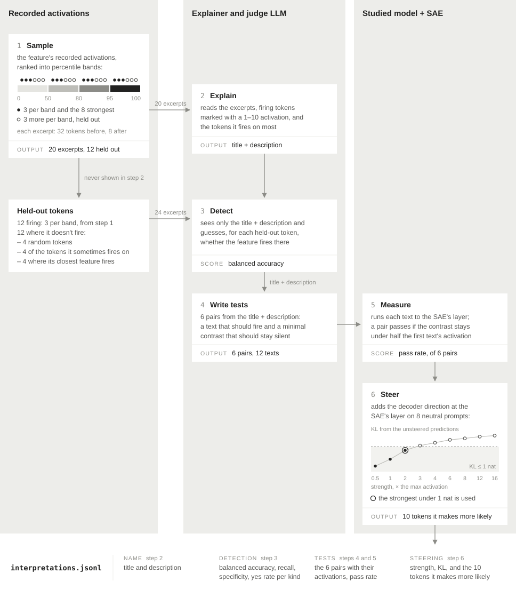

# Feature interpretation



## Run

```sh
llama-server -m gemma-4-31B-it-qat-UD-Q4_K_XL.gguf --port 8080 -c 32768 -np 4 -cram 0 --reasoning off
python3 interpret.py --sae-dir artifacts/qwen3-1.7b-base_l20_w16_k32_500m --base-url http://127.0.0.1:8080/v1 --sample 1000
python3 explore.py --sae-dir artifacts/qwen3-1.7b-base_l20_w16_k32_500m
```

- `--sample N` picks N features spread over activation density
- Results go to `interpretations.jsonl` in the activation directory (a rerun resumes where it stopped)
- `-cram 0` keeps llama-server's prompt cache from filling RAM. A feature takes about 25 s on an M4 Max.

## How it works

1. **Sample**: 20 excerpts where the feature fires, from its strongest to its weakest activations, plus 12 more held out for step 3. [1]
2. **Explain**: the LLM reads the excerpts and writes a title and description.
3. **Detect**: a fresh LLM call, given only the title and description, guesses whether the feature fires on 24 unseen tokens. Half are firing tokens, half are tokens where it stays silent: random ones, ones it sometimes fires on, and ones where its most similar feature fires. The score is balanced accuracy, where 0.5 is chance. [1]
4. **Write tests**: the LLM writes 6 pairs of texts: one that should make the feature fire, and a minimal edit that shouldn't.
5. **Measure**: the studied model reads each text, and a pair passes if the edit at least halves the activation. [2, 3]
6. **Steer**: the feature's direction is added to the model, as strongly as possible while changing its next-token predictions by at most 1 nat of KL, and the 10 tokens that become most likely are recorded. [4, 5]

A title and description is **trusted** when detection is at least 0.7 and at least 4 of 6 tests pass. The explorer lists trusted features first, then low-confidence ones, then features without a title. Detection checks that the description covers where the feature fires, tests check that the conditions it states are real.

Sources:
- [1] [Automatically Interpreting Millions of Features in Large Language Models](https://arxiv.org/abs/2410.13928)
- [2] [FADE: Why Bad Descriptions Happen to Good Features](https://arxiv.org/abs/2502.16994)
- [3] [SAEExplainer: Interpreting SAE Features with Activation-Guided Preference Optimization](https://arxiv.org/abs/2606.08496)
- [4] [SAEs Are Good for Steering – If You Select the Right Features](https://arxiv.org/abs/2505.20063)
- [5] [Enhancing Automated Interpretability with Output-Centric Feature Descriptions](https://arxiv.org/abs/2501.08319)
