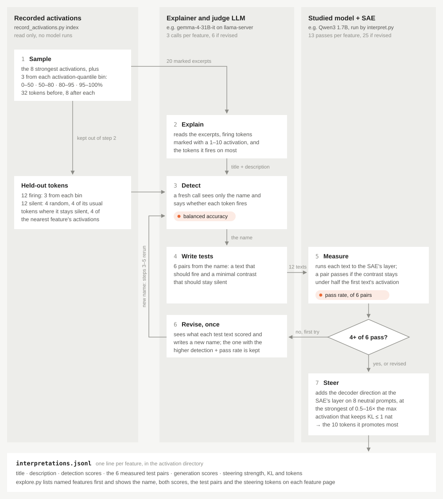

# Feature interpretation

`interpret.py` has an LLM write a title and description for each SAE feature. It then checks whether they are right in two independent ways, and records which tokens the feature makes more likely when added to the model. Everything shows up in the explorer.



## Run

Start a judge LLM, interpret a sample of features, then browse them:

```sh
llama-server -m gemma-4-31B-it-Q8_0.gguf --port 8080 -c 32768 -np 4 -cram 0 --reasoning off
python3 interpret.py --sae-dir artifacts/qwen3-1.7b-base_l20_w16_k32_500m --base-url http://127.0.0.1:8080/v1 --sample 1000
python3 explore.py --sae-dir artifacts/qwen3-1.7b-base_l20_w16_k32_500m
```

- `--sample N` picks N features spread over activation density, `--features` picks specific ones, and without either every feature with at least 1,000 recorded activations is interpreted. Rarer features barely make the SAE's top k, so their activations are small and vanish with any change of context: their titles come out vague and their tests fail.
- Results go to `interpretations.jsonl` in the activation directory. A rerun skips the features already there, so an interrupted run resumes.
- `-cram 0` keeps llama-server's prompt cache from filling RAM, `--reasoning off` makes the LLM answer directly, and `-np 4` matches `interpret.py`'s 4 workers.
- With gemma-4-31B-it on an M4 Max, a feature takes about 45 s (1,000 in about 12 hours). gemma-4-12B-it is about 3x faster but its titles and descriptions pass fewer tests.

## How it works

The steps match the diagram.

1. **Sample.** Pick 20 excerpts where the feature fires: the 8 strongest, plus 3 from each activation band (0-50, 50-80, 80-95 and 95-100th percentile), so that the title and description cover how the feature usually fires, not only its peak. 12 more are kept aside for step 3. [1]
2. **Explain.** The LLM reads the excerpts, with the firing tokens marked by strength, and writes a title and description.
3. **Detect.** A fresh LLM call sees only the title and description and guesses, for 24 tokens it has never seen, whether the feature fires there. Half are firing tokens. The other half are tokens where it stays silent, including tricky ones: tokens it fires on only sometimes, in places where it doesn't, and tokens where its most similar feature fires. A title and description that only list tokens, or are too vague, fail on those. The score is balanced accuracy: 0.5 is chance, 1 is perfect. [1]
4. **Write tests.** The LLM writes 6 pairs of new texts: one that should make the feature fire, and a minimal edit of it that should not. The edit comes at or before the token where the feature should fire, since the model reads left to right.
5. **Measure.** The studied model reads each text and the SAE measures the feature. A pair passes if the edit at least halves the activation. Here the model itself is the judge, which catches titles and descriptions that fit the examples but are too broad. [2, 3]
6. **Revise.** If fewer than 4 of 6 pairs pass, the LLM sees the measured activations and rewrites the title and description once. Steps 3-5 run again, and the version with the better scores is kept. [3]
7. **Steer.** The feature's direction is added to the model on 8 neutral prompts, and the 10 next tokens whose probability rises the most are recorded. This shows what the feature does to the output, which can differ from what it fires on. [4, 5]

   The strength is the strongest one that changes the next-token predictions by at most 1 nat of KL divergence. A weaker push barely changes anything, and a stronger one makes the model output generic junk. A fixed strength would not work either: at 4x the max activation, the KL ranges from 0.7 to 6.8 nats across features.

## Reading the scores

- **Detection** says whether the title and description cover where the feature fires. **Tests** say whether the conditions they state are real. The two barely correlate, so both matter:
  - Feature 7778, "Possessive or Contraction Apostrophe", scores 0.92 on detection, but none of its 6 tests fire. It fires on a standalone apostrophe token, as in "the dogs' leash" or "Charles' book". The tokenizer merges the apostrophe in "Sarah's" and "doesn't" into `'s` and `'t`, so the feature never fires on standard possessives and contractions.
  - Feature 28476, "Applied Sciences and Academic Disciplines", passes all 6 tests ("Applied Physics" fires, "Theoretical Physics" doesn't), but detection is at chance: most of its activations are on words like " apply" and " application", which the description calls weak.
- A title and description is trusted when it passes both checks: detection of at least 0.7 and at least 4 of 6 passing tests. Every feature is saved either way, and the explorer lists trusted features first, then low-confidence ones (greyed out and tagged), then features without a title.
- Steering tokens are recorded separately from the title and description. They often agree (feature 14551, on bending and curving, steers toward " sideways", " forward", " downward"), but sometimes show something more: feature 27441 fires on the first comma of lists like "local, state and national", and steers toward " middle", " intermediate", " medium", the item it expects next.

## Results

1,000 features of the Qwen3 1.7B layer-20 SAE, spread over activation density (the `--sample 1000` command above), with gemma-4-31B-it writing and judging:

- Detection averages 0.71. The judge recognizes 80% of the strongest activations (top 5%) but only 32% of the weakest half: titles and descriptions describe the peak better than the tail.
- 64% of test pairs pass, 64% of features pass at least 4 of 6, and 10% pass none.
- 39% of features are trusted, and 30% of the titles and descriptions were revised.
- Rarer features are easier to describe. 69% are trusted in the rarest tenth (1,000 to 5,800 activations in 100M tokens), but only 8% in the densest tenth (over 340,000): those fire in so many contexts that the title only covers the strongest.
- The steering strength is 1-4x the max activation for 93% of features.

Detection measures the description, not just the tokens it names. On 200 of these features and a fresh set of held-out tokens, the judge did much better with the explainer's title and description than with a token list or another feature's description:

| Judge given | Balanced accuracy |
|---|---:|
| The explainer's title and description | 0.73 |
| Only the feature's most frequent tokens | 0.62 |
| Another feature's title and description | 0.50 |

Sources:
- [1] [Automatically Interpreting Millions of Features in Large Language Models](https://arxiv.org/abs/2410.13928)
- [2] [FADE: Why Bad Descriptions Happen to Good Features](https://arxiv.org/abs/2502.16994)
- [3] [SAEExplainer: Interpreting SAE Features with Activation-Guided Preference Optimization](https://arxiv.org/abs/2606.08496)
- [4] [SAEs Are Good for Steering – If You Select the Right Features](https://arxiv.org/abs/2505.20063)
- [5] [Enhancing Automated Interpretability with Output-Centric Feature Descriptions](https://arxiv.org/abs/2501.08319)
